# Highly Available Drupal Platform on AWS

A Drupal 10 website that stays online when a server or a whole data center fails. The entire platform is code: Terraform builds the infrastructure, Ansible configures the servers, GitHub Actions tests and deploys changes, and Prometheus and Grafana watch everything.

Built by **Esther Durojaye**, Infrastructure and Cloud Engineer.

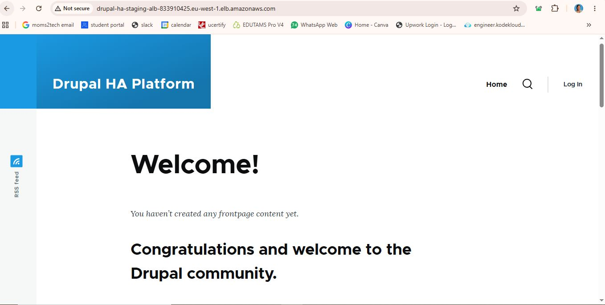

## What it does

- **Multi-zone high availability:** two Availability Zones in `eu-west-1` (Ireland), a load balancer, a Multi-AZ MySQL database and shared file storage.
- **Auto scaling:** 2 to 4 Drupal servers, scaling at 60% average CPU. Failed servers are replaced automatically.
- **Infrastructure as code:** one `terraform apply` builds 64 AWS resources.
- **Automatic configuration:** each server installs Drupal, PHP and Apache by itself at first boot using Ansible.
- **CI/CD:** every change is validated, tested, deployed to staging and smoke-tested. Production waits for a manual approval. AWS access uses short-lived OIDC tokens, so no keys are stored in GitHub.
- **Monitoring and logging:** Prometheus, Grafana, alert rules, CloudWatch alarms and central logs.
- **Containers:** the same site runs with Docker Compose, and Kubernetes manifests are included.

## Architecture

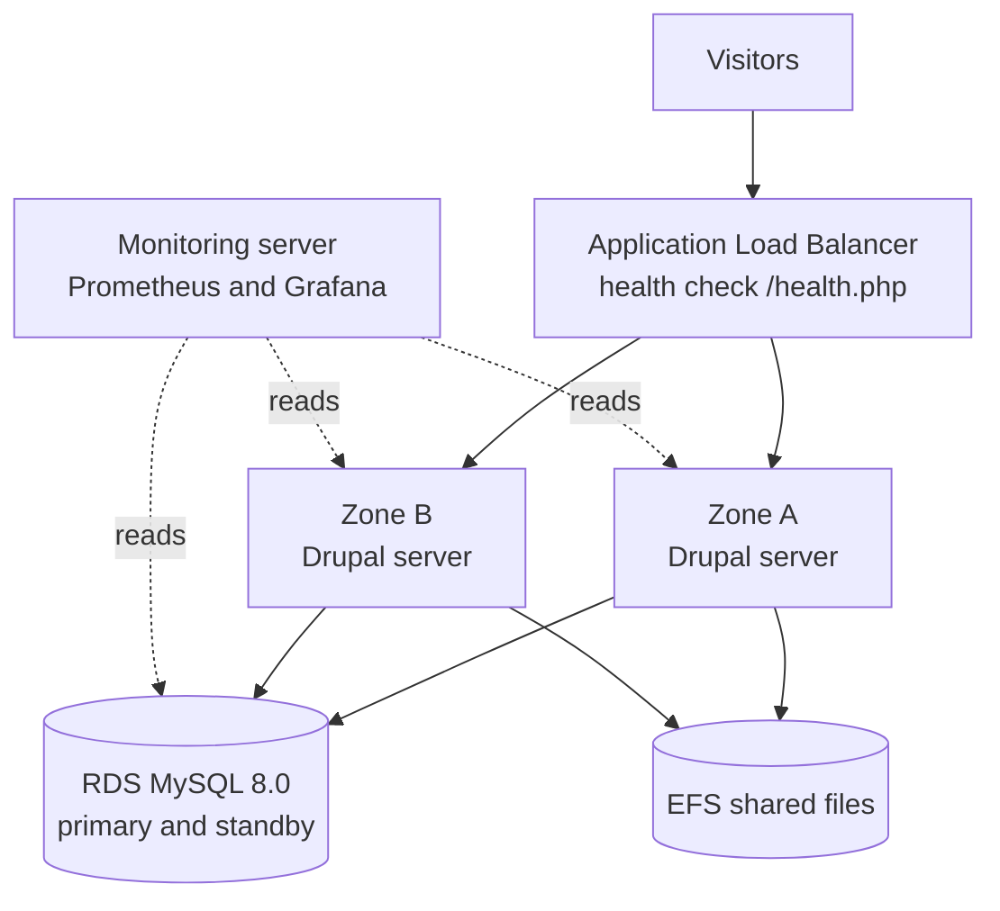

| Layer | Service | Notes |
| --- | --- | --- |
| Network | VPC, public, app and data subnets in 2 zones, NAT gateway | Servers and database are in private subnets |
| Entry | Application Load Balancer | Sends traffic only to healthy servers |
| Compute | Auto Scaling group, Ubuntu 22.04, PHP 8.1, Drupal 10 | Servers managed through Session Manager, no SSH |
| Data | RDS MySQL 8.0 (Multi-AZ), EFS | Database credentials in Secrets Manager |
| Monitoring | Prometheus, Grafana, CloudWatch | Servers found automatically by their AWS tag |

## Screenshots

### Infrastructure

| Load balancer | Target group health |
| --- | --- |
| 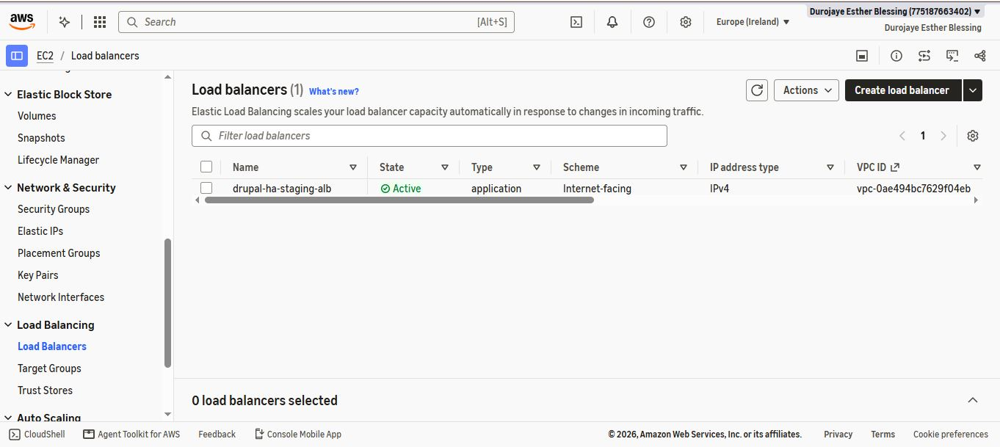 | 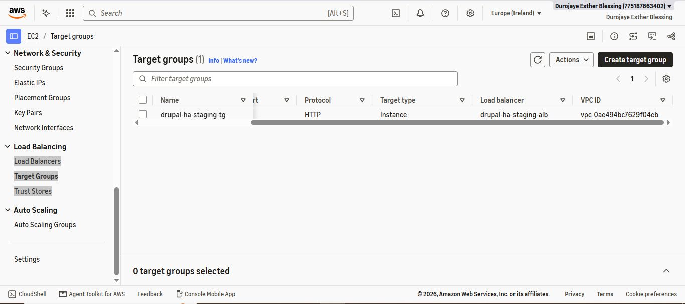 |

| Auto Scaling group | EC2 instances across two zones |
| --- | --- |
| 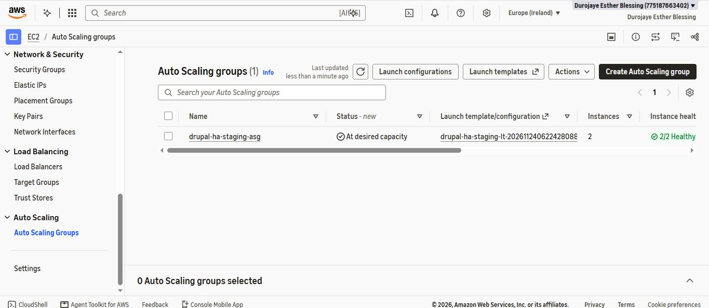 | 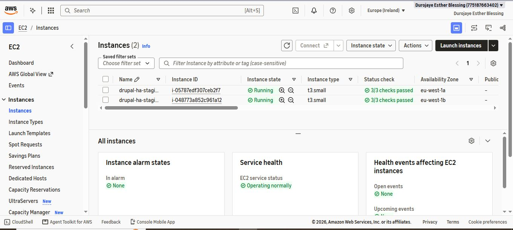 |

| Multi-AZ database | Health check |
| --- | --- |
| 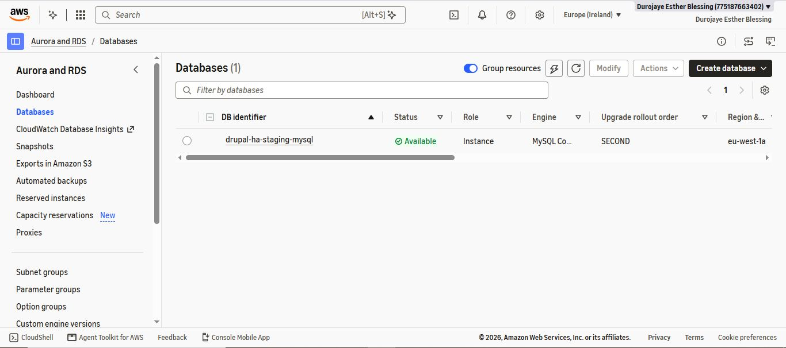 | 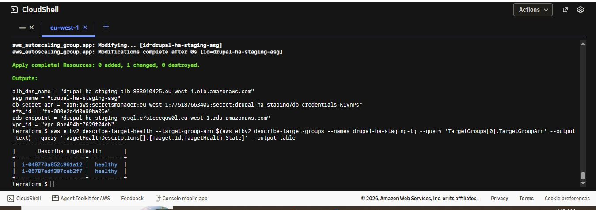 |

### Application and pipeline

| Drupal admin logged in | GitHub Actions pipeline |
| --- | --- |
| 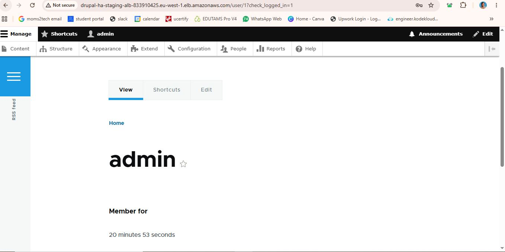 | 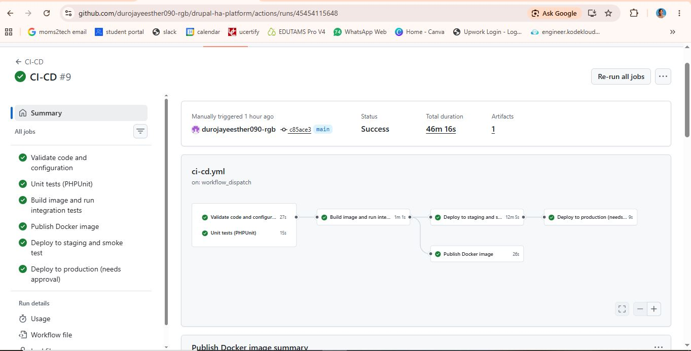 |

### Monitoring

| Grafana: servers | Grafana: Apache |
| --- | --- |
| 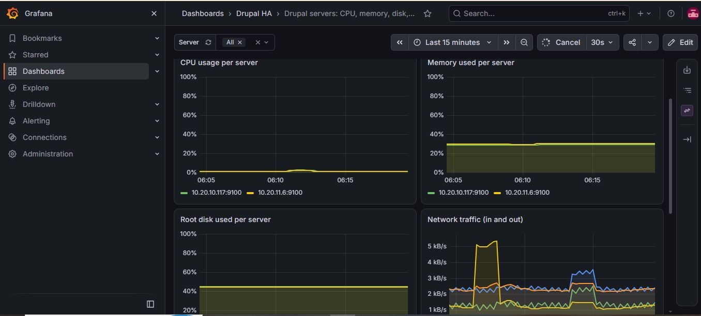 | 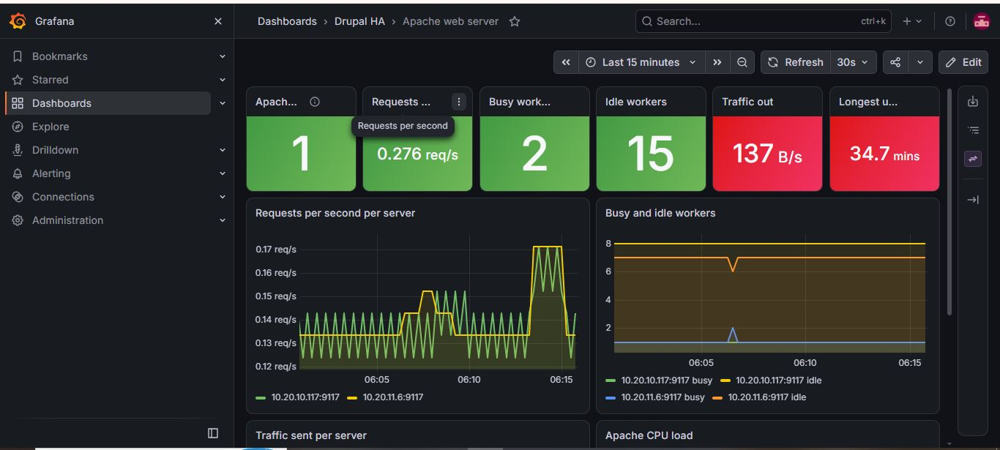 |

| Grafana: database | Prometheus targets |
| --- | --- |
| 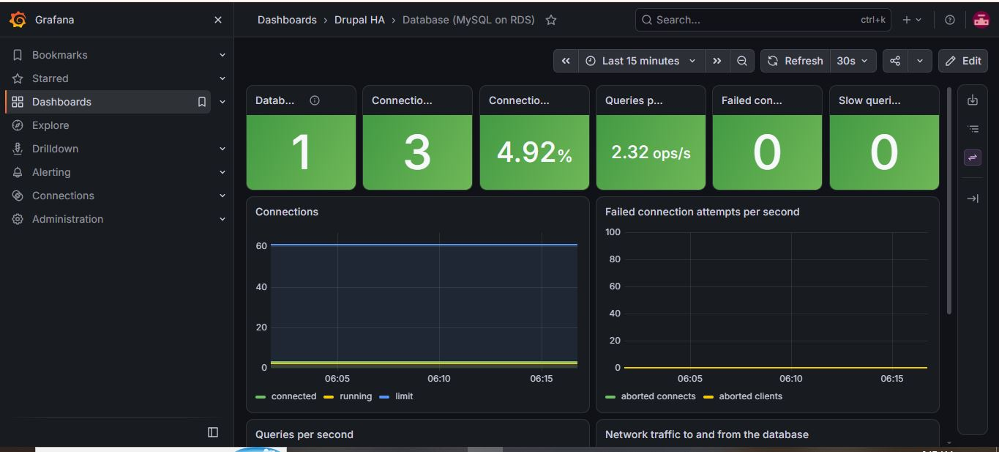 | 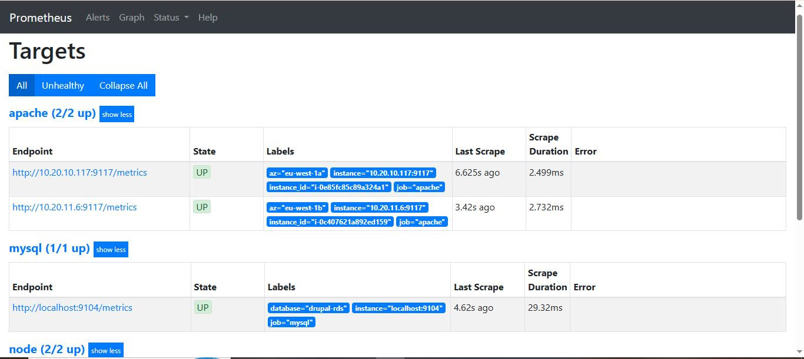 |

| Prometheus targets (continued) | Prometheus alert rules |
| --- | --- |
| 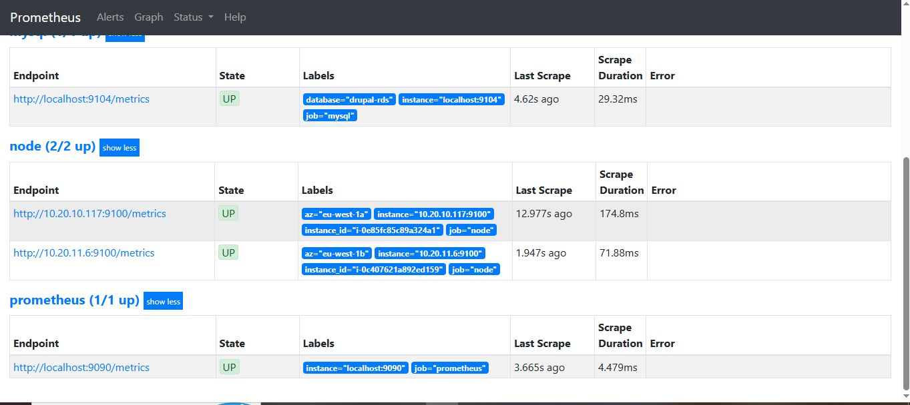 | 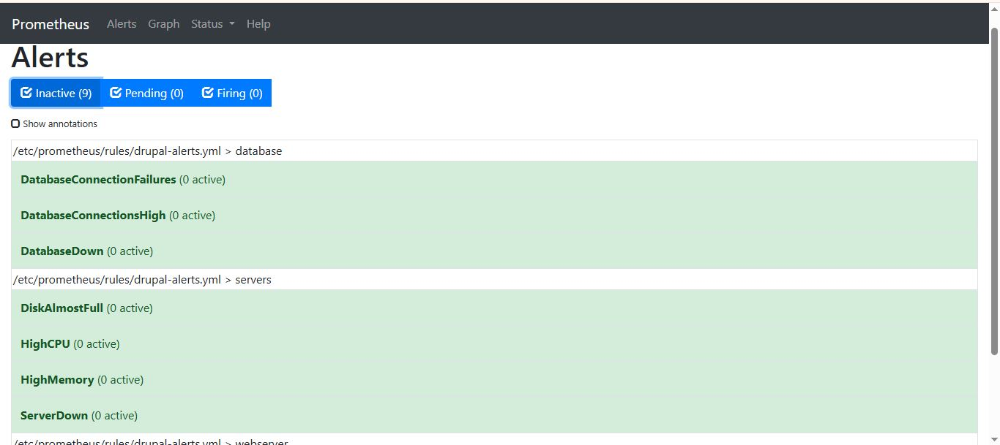 |

## Repository layout

| Folder | Contents |
| --- | --- |
| `terraform/` | AWS infrastructure (network, security, load balancer, database, storage, compute, monitoring, GitHub deploy role) |
| `ansible/` | `site.yml` for Drupal servers and `monitoring.yml` for the monitoring server, with roles `common`, `efs`, `webserver`, `drupal`, `exporters`, `logging`, `monitoring` |
| `docker/`, `docker-compose.yml` | Container image and local stack with MariaDB |
| `k8s/` | Kubernetes manifests: base, `local` (kind) and `eks` overlays |
| `.github/` | CI/CD workflow and the rolling-deploy action |
| `tests/` | Smoke, integration and PHPUnit tests |
| `monitoring/` | Prometheus settings and alert rules, Grafana data sources and four dashboards |
| `docs/screenshots/` | Evidence from the working deployment |

## Deploy it

You need an AWS account and a browser. Everything runs in **AWS CloudShell** (region Ireland).

```bash
git clone https://github.com/durojayeesther090-rgb/drupal-ha-platform.git
cd drupal-ha-platform/terraform
export TF_DATA_DIR=/tmp/tfdata
terraform init
terraform apply -var-file=staging.tfvars -var="monitoring_allowed_cidr=YOUR_IP/32"
```

1. Type `yes` when asked. It takes about 15 minutes.
2. Wait about 10 more minutes while the servers install Drupal.
3. Open the `alb_dns_name` output in a browser.
4. Open `grafana_url` (user `admin`). Run the `grafana_password_command` output to print the password.
5. Destroy everything when finished to stop the cost:

```bash
terraform destroy -var-file=staging.tfvars -var="monitoring_allowed_cidr=YOUR_IP/32"
```

Set `github_oidc_provider_exists = true` in `staging.tfvars` if your AWS account already has the GitHub identity provider. Re-run `terraform init` if CloudShell restarts.

## CI/CD pipeline

`.github/workflows/ci-cd.yml` runs on every push to `main`:

1. **Validate:** Terraform, Ansible, Dockerfile, shell and PHP checks, Kubernetes manifests, alert rules and dashboards.
2. **Unit tests:** PHPUnit.
3. **Build and integration test:** the full stack runs in Docker Compose, including a restart test.
4. **Publish image** to GitHub Container Registry.
5. **Deploy to staging:** servers are replaced one at a time, then smoke tests run against the load balancer.
6. **Approve:** the `production` environment needs a reviewer to click Approve.
7. **Deploy to production.**

One-time GitHub setup: add the repository variable `AWS_DEPLOY_ROLE_ARN` (from the Terraform output `github_actions_role_arn`) and create a `production` environment with required reviewers.

## Monitoring and logging

- **Prometheus** finds Drupal servers by their AWS tag and collects CPU, memory, disk, network, Apache and database metrics.
- **Grafana** has four dashboards: servers, Apache, database, and load balancer with RDS (the CloudWatch dashboard).
- **Alert rules** cover server, Apache and database down, high CPU, memory and disk, exhausted Apache workers, and database connection failures.
- **CloudWatch** keeps Apache, system and bootstrap logs from every server, and sends email alarms for load balancer errors, unhealthy servers and database load (set `alert_email`).

## Recovery

| Failure | Result |
| --- | --- |
| A server dies | Auto Scaling replaces it; the load balancer skips it |
| A whole zone is lost | The other zone keeps serving; the database standby takes over |
| Traffic spikes | Servers scale from 2 up to 4 |
| Total loss | Rebuild from code in about 15 minutes; the database restores from backup |

Database backups are kept for 1 day on a free-tier AWS account and 7 days otherwise (`db_backup_retention_days`).

## Known limits

- The Kubernetes overlay for EKS is written and validated but was not run on a real cluster.
- Production is configured (`production.tfvars`) with an approval gate, but a separate production stack was not built.
- The Grafana CloudWatch dashboard for the load balancer was not verified live; the AWS console shows the same numbers.
- Drupal 10 security support ends in December 2026; the next step is an upgrade to Drupal 11.
- Grafana and Prometheus use plain HTTP and are limited to one IP address.

## Problems solved along the way

A few real issues met during the build: a laptop too small for Terraform (moved to CloudShell), RDS free-tier backup limits, Docker running out of disk space, a GitHub change to its identity format that locked AWS out, a pipeline step skipped because one variable was missing, and a Grafana crash caused by an overwritten settings file. Each one was traced to its cause from the error message and fixed in code.
